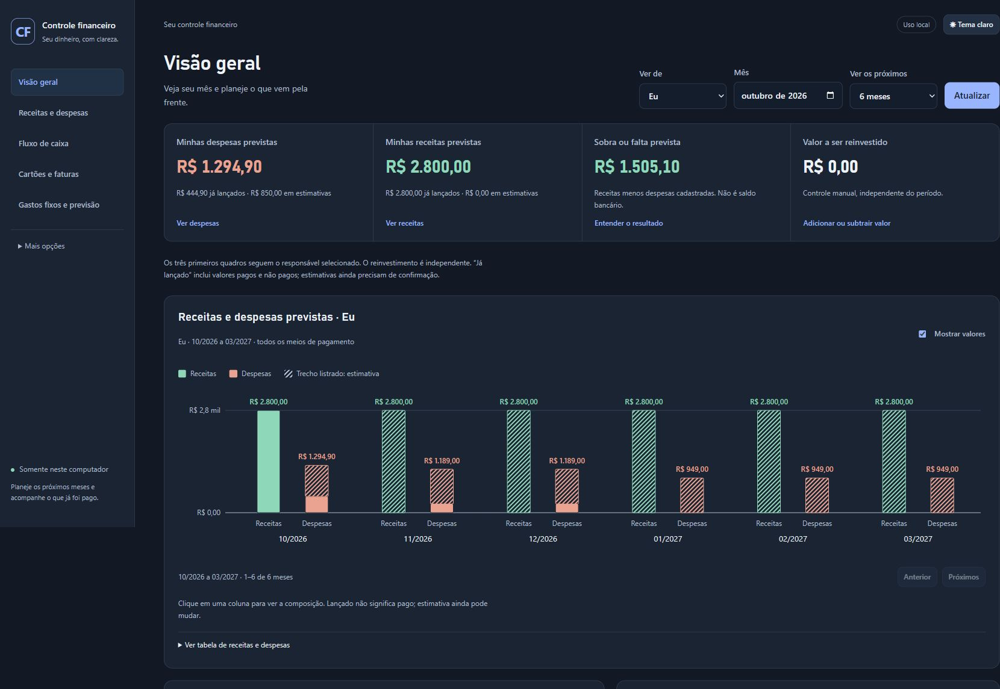

# Controle de finanças pessoais

Aplicação web local para praticar Python, SQL, APIs, interface web e testes por meio de um controle financeiro. O intuito do projeto é o aprendizado e o treinamento das tecnologias utilizadas, além da prática de desenvolvimento e estudo com auxílio de um agente de IA, o OpenAI Codex.

O Codex apoiou o desenvolvimento, a compreensão dos conceitos e a verificação do código. As regras e os exemplos podem ser explorados como material de estudo.

## Prévia



Captura da aplicação com dados inteiramente fictícios. Para experimentar, siga a instalação abaixo e escolha banco vazio ou de exemplo.

[Orientações de uso](docs/USO.md) · [Organização técnica](docs/ARQUITETURA.md) · [Cenário fictício](examples/README.md)

## O que a aplicação permite explorar

- Receitas, despesas, categorias e responsabilidades Eu e Pai/Mãe.
- Compras parceladas, ciclos de cartão, faturas e pagamentos registrados explicitamente.
- Gastos recorrentes e projeções, com distinção entre registrado e estimado.
- Orçamento, gráficos, filtros, composição dos valores e fluxo de caixa.
- Backups locais, restauração para outro arquivo e histórico auditável.

Pagamento de fatura não cria uma segunda despesa; repasse familiar não é receita pessoal. Dinheiro é representado em centavos inteiros. Previsões não são pagamentos.

## Tecnologias

Python 3.12, FastAPI, Pydantic, Uvicorn, Jinja2, SQLAlchemy, Alembic e SQLite; HTML, CSS, JavaScript e SVG; pytest e testes JavaScript com Node.js. As versões de referência estão em `requirements-dev.lock.txt`.

## Duas modalidades

O mesmo código oferece dois pontos de partida independentes:

| Modalidade | Conteúdo inicial | Preparação |
|---|---|---|
| Vazia | Esquema atualizado, nenhuma linha de negócio e indicador de reinvestimento zerado | `python -m scripts.prepare_database empty --database data/empty.db` |
| Exemplo | Banco novo com receitas, despesas, parcelas, categorias e previsões inteiramente fictícias | `python -m scripts.prepare_database demo --database data/demo.db` |

O repositório distribui código, documentação e uma captura da aplicação com dados fictícios. Os bancos SQLite são gerados localmente e ficam fora do Git. O preparador recusa arquivos existentes; ele não apaga bancos. Dados fictícios são criados do zero, sem copiar transações pessoais. [Cenário de exemplo](examples/README.md).

## Instalação e execução

Clone ou baixe este repositório para uma pasta local fora de pastas sincronizadas. No PowerShell, a partir da raiz do projeto:

```powershell
py -3.12 -m venv .venv
.\.venv\Scripts\python.exe -m pip install -r requirements-dev.lock.txt
.\.venv\Scripts\python.exe -m pip install --no-deps -e ".[dev]"
```

Prepare e abra a versão vazia:

```powershell
.\.venv\Scripts\python.exe -m scripts.prepare_database empty --database data/empty.db
.\.venv\Scripts\python.exe -m app --database data/empty.db --port 8010
```

Ou prepare e abra a versão de exemplo:

```powershell
.\.venv\Scripts\python.exe -m scripts.prepare_database demo --database data/demo.db
.\.venv\Scripts\python.exe -m app --database data/demo.db --port 8011
```

Acesse `http://127.0.0.1:8010` ou `http://127.0.0.1:8011`, conforme a modalidade. Encerre pelo terminal com Ctrl+C. Use portas distintas para manter as duas abertas. Outros sistemas podem usar `python3.12` e `.venv/bin/python` nos comandos equivalentes.

O modo de exemplo usa o mês local atual; para uma referência fixa, acrescente `--month 2026-10` ao comando de preparação e selecione esse mês na interface. [Orientações de uso](docs/USO.md).

## Verificação

```powershell
.\.venv\Scripts\python.exe -m pytest -q
node --test tests/test_money_ui.mjs tests/test_settlement_money.mjs tests/test_dashboard_chart.mjs tests/chart_geometry.test.mjs tests/entry_categories.test.mjs
```

Os testes utilizam bancos temporários e dados de teste. [Arquitetura](docs/ARQUITETURA.md).

## Escopo

Projeto educacional para execução local, sem integração bancária, autenticação multiusuário ou hospedagem pública. O servidor permanece em `127.0.0.1`, com validação de origem e proteção CSRF. GitHub hospeda o código; não executa o backend Python como um site do GitHub Pages.

Os rótulos de instituições e responsabilidades representam configurações didáticas. Funcionalidades de importação exigem análise e confirmação próprias; não é necessário importar planilhas para experimentar as duas modalidades.


## Verificação automática

O workflow executa os testes Python e JavaScript em Linux e Windows, com Python 3.12 e Node.js 24. A execução ocorre em alterações de `main`, pull requests e acionamentos manuais. Consulte o resultado em [GitHub Actions](https://github.com/GabrielBSouza15/controle-financas/actions/workflows/testes.yml).

## Licença

[MIT](LICENSE), para o conteúdo publicado neste repositório.
